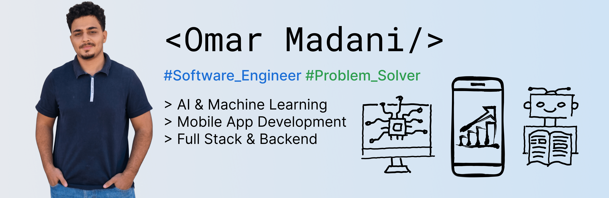

  

## About Me

I am a developer specializing in mobile application development and artificial intelligence

I deliver projects end to end from UI/UX design and development to testing backend and full source code

I studied Artificial Intelligence at university so I can also add smart features to your app such as prediction data analysis and image recognition

## Languages and Tools

  
  
  
  
  
  
  
  
  
  
  
  
  
  
  
  
  
  
  
  

## Featured Projects

### [Wader](https://github.com/omarmadany/wader)
A water-tracking app with an interactive water-fill effect.
`HTML` `CSS` `JavaScript`

## Contact

<h3 align="center">Have an idea? Let's build it together 🚀</h3>

  

  
  
  

  
  
  

